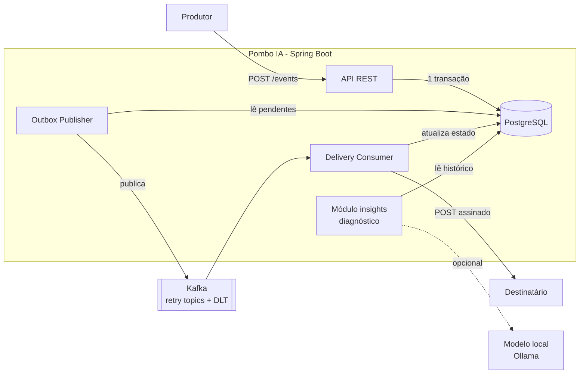
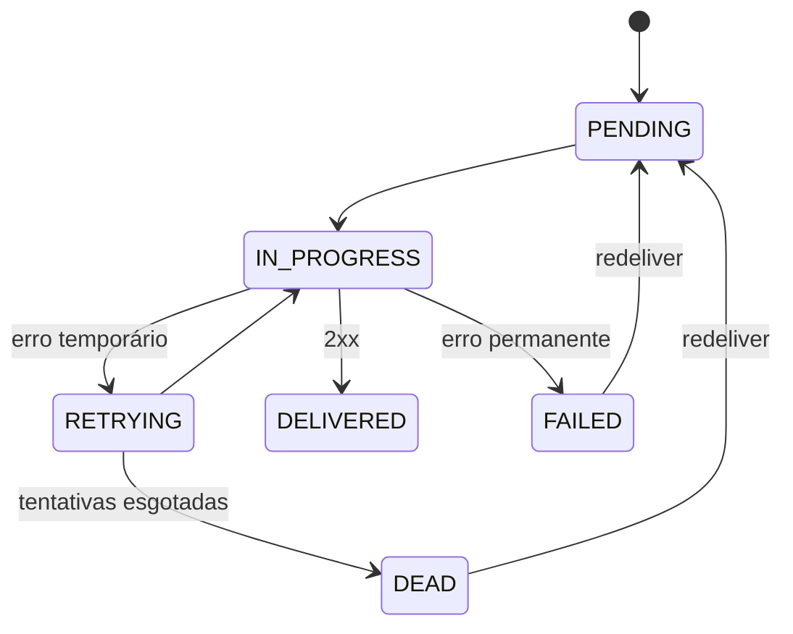
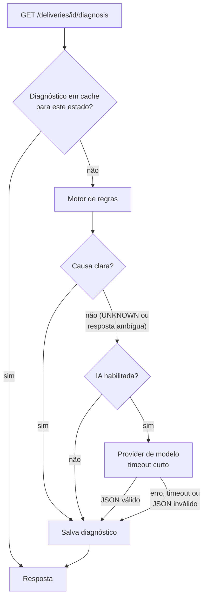

<div align="center">

# 🕊️ Pombo IA

**Entrega confiável de webhooks, com diagnóstico inteligente de falhas**
Receba eventos pela API e entregue-os a qualquer URL com assinatura HMAC, retentativas controladas, Dead Letter Topic e histórico auditável. Quando algo falha, a IA explica o motivo e sugere o que fazer.


[](https://github.com/tpsousa/pombo/actions/workflows/ci.yml)


</div>

> 🚧 **Em desenvolvimento.** Este README descreve o produto-alvo. A seção [Status e roadmap](#status-e-roadmap) mostra o que já está pronto.

---

## O problema

Notificar outro sistema via webhook parece simples, até que o destino fica fora do ar, responde devagar ou recebe a mesma notificação duas vezes. Fazer a chamada HTTP dentro da requisição da API ainda acopla a sua disponibilidade à do cliente.

E quando a entrega falha, o desenvolvedor recebe uma lista de códigos (`401`, `503`, `TIMEOUT`) e precisa deduzir sozinho o que aconteceu.

O **Pombo IA** resolve as duas partes:

**Entrega confiável**
- ✅ Aceita o evento rapidamente (`202 Accepted`) e entrega **de forma assíncrona**
- ✅ **Retentativas** com backoff exponencial e limite definido
- ✅ **Dead Letter Topic** para entregas esgotadas e **reenvio manual**
- ✅ **Assinatura HMAC-SHA256** em cada entrega, com proteção anti-replay
- ✅ **Histórico completo** de tentativas (status HTTP, duração, erro)
- ✅ **Transactional Outbox**: nenhum evento aceito é perdido entre o banco e o Kafka
- ✅ Proteção contra **SSRF** no cadastro e na entrega

**Diagnóstico com IA**
- 🧠 Explica em linguagem natural **por que** uma entrega falhou e sugere a ação
- 🧠 **Regras primeiro, modelo depois**: casos óbvios nunca chamam um modelo
- 🧠 Funciona com **modelo local (Ollama)**, sem API paga e sem enviar dados a terceiros
- 🧠 Agente via **MCP** para investigar entregas por conversa
- 🧠 Tudo **opcional**: com a IA desligada, o Pombo funciona normalmente

> Garantia de entrega: **at-least-once**. O destinatário deve deduplicar por `X-Pombo-Delivery-Id`, que é estável em todas as tentativas.

## Como funciona



1. `POST /events` grava **evento, entregas e mensagens de outbox na mesma transação** e responde `202`.
2. O publicador do outbox envia as mensagens ao Kafka (`acks=all`, producer idempotente).
3. O consumidor assume a entrega com uma transição de estado condicional (idempotência), faz o `POST` assinado e registra a tentativa.
4. Erro temporário → retry topic com backoff. Erro permanente (`4xx`) → `FAILED`. Tentativas esgotadas → `DEAD` + DLT.
5. Em qualquer entrega com falha, `GET /deliveries/{id}/diagnosis` devolve a explicação.

### Estados de uma entrega



---

## 🧠 Pombo IA: como a IA funciona

### Por que IA aqui, e o que ela não faz

A IA existe para resolver uma dor concreta: **traduzir o histórico técnico de uma entrega falha em uma explicação acionável**. Ela **não** participa do caminho de entrega: não decide retentativas, não altera estados e não vê o conteúdo dos eventos.

| A IA faz | A IA não faz |
|---|---|
| Classifica a causa provável da falha | Decidir se uma entrega deve ser retentada |
| Explica em português e sugere a ação | Ler ou enviar o payload dos eventos |
| Responde perguntas sobre entregas (via MCP) | Reenviar entregas sem confirmação humana |
| Resume o estado operacional | Detectar anomalias (isso é feito com métricas e alertas) |

### Arquitetura: regras primeiro, modelo depois



O módulo `com.pombo.insights` fica **isolado**: não altera o fluxo de entrega e só lê o histórico. Se ele falhar, nada mais é afetado.

```
insights/
├── DiagnosisProvider              ← interface única
├── RuleBasedDiagnosisProvider     ← padrão: sem IA, sem custo
├── OllamaDiagnosisProvider        ← modelo local
├── HostedApiDiagnosisProvider     ← opcional, API externa
├── DiagnosisService               ← cache, fallback, métricas
├── DiagnosisInput                 ← somente metadados (ver "Privacidade")
└── mcp/                           ← servidor MCP (ferramentas somente leitura)
```

A escolha do provedor é configuração, não código:

```yaml
pombo:
  insights:
    enabled: true            # padrão: false
    provider: rules          # rules | ollama | hosted
    timeout: 10s
    include-response-snippet: false
```

### Motor de regras

Resolve os casos mais comuns de forma determinística e instantânea:

| Sinal no histórico | Categoria | Confiança |
|---|---|---|
| `401` / `403` em todas as tentativas | `AUTH_REJECTED` | Alta |
| `404` / `410` | `ENDPOINT_NOT_FOUND` | Alta |
| `429` | `RATE_LIMITED` | Alta |
| `5xx` recorrente | `TARGET_SERVER_ERROR` | Alta |
| `TIMEOUT` em 2 ou mais tentativas | `TARGET_TIMEOUT` | Alta |
| `DNS_FAILURE` | `DNS_FAILURE` | Alta |
| `CONNECTION_REFUSED` | `TARGET_DOWN` | Alta |
| `BLOCKED_TARGET` (proteção SSRF) | `BLOCKED_TARGET` | Alta |
| `400` / `422` com mensagem no corpo da resposta | `VALIDATION_REJECTED` | Média (o modelo ajuda a interpretar) |
| Padrão misto ou sem correspondência | `UNKNOWN` | Baixa (vai para o modelo, se habilitado) |

### Onde o modelo realmente agrega

O modelo só entra quando as regras não bastam:

1. **Interpretar a resposta do destinatário.** Um `400` com `"invalid signature: timestamp too old"` vira *"o receptor rejeitou a assinatura por diferença de relógio; verifique a sincronização de horário"*.
2. **Explicar padrões mistos** (por exemplo, `503` seguido de `timeout` e depois `401`).
3. **Redigir** a explicação e a ação sugerida de forma clara.

A saída do modelo é **sempre estruturada** (JSON) e **validada**: a categoria precisa pertencer à lista fixa e os campos têm tamanho máximo. Resposta inválida, vazia ou fora do prazo faz o sistema usar o resultado das regras. O modelo nunca é a única fonte de verdade.

### Contrato da API

`GET /api/v1/deliveries/{id}/diagnosis` (somente entregas `RETRYING`, `FAILED` ou `DEAD`)

```json
{
  "deliveryId": "3b9a8d2c-...",
  "category": "AUTH_REJECTED",
  "summary": "O destino respondeu 401 em todas as 5 tentativas.",
  "suggestedAction": "Verifique a validação de assinatura ou o token no receptor e use redeliver depois de corrigir.",
  "confidence": "HIGH",
  "source": "RULES",
  "model": null,
  "basedOnAttempts": 5,
  "generatedAt": "2026-01-10T14:12:00Z"
}
```

| `source` | Significado |
|---|---|
| `RULES` | Resolvido pelo motor de regras |
| `LLM` | Explicação gerada pelo modelo (campo `model` preenchido) |
| `RULES_FALLBACK` | O modelo falhou ou estava indisponível; resultado das regras |

Códigos: `200`, `404` (entrega inexistente ou de outro usuário), `409` (entrega sem falha para diagnosticar), `503` (recurso desabilitado).

### Cache

Diagnósticos ficam na tabela `delivery_diagnoses`, com chave `(delivery_id, attempt_count)`. Uma entrega finalizada não muda, então o diagnóstico é calculado uma vez. Se surgir uma nova tentativa, o cache daquele estado deixa de valer. Isso reduz custo, latência e carga no modelo.

### Privacidade e segurança

| Risco | Decisão |
|---|---|
| **Vazamento de dados do cliente** | O modelo recebe **somente metadados**: status, contagem de tentativas, códigos HTTP, tempos, códigos de erro e o *host* do destino. **Nunca** o payload do evento, nem o segredo, nem o caminho e a query da URL. |
| **Trecho da resposta do destinatário** | Desligado por padrão (`include-response-snippet: false`). Quando ligado, é truncado, sanitizado e tratado como **dado não confiável**. |
| **Prompt injection** | O texto vindo de servidores externos fica em um bloco delimitado e marcado como dado. O modelo não executa ações, e a saída é validada contra um esquema fixo. |
| **Isolamento entre usuários** | O diagnóstico usa o usuário autenticado. Nenhuma ferramenta recebe `userId` escolhido pelo modelo. |
| **Custo e abuso** | Limite de requisições por usuário, timeout curto e cache. |
| **Dependência do modelo** | Recurso desligado por padrão, com *fallback* para regras em qualquer falha. |
| **Chaves de API** | Quando houver provedor externo, a chave vem de variável de ambiente ou do Secrets Manager. Nunca do repositório. |

### Modelo local com Ollama (sem custo de API)

O Ollama roda na sua máquina, sem chave e sem cobrança, e nenhum dado sai do ambiente. Ele entra no Compose como perfil opcional:

```bash
docker compose --profile ai up -d
docker compose exec ollama ollama pull <modelo>      # escolha um modelo pequeno (3B a 8B)
```

```yaml
pombo:
  insights:
    enabled: true
    provider: ollama
    ollama:
      base-url: http://ollama:11434
      model: <modelo>
```

Modelos pequenos bastam para classificar falhas e redigir a explicação. Consulte a biblioteca do Ollama para ver as opções disponíveis. O consumo de memória e CPU depende do modelo escolhido, então a IA local **não** faz parte do perfil econômico da AWS: lá o provedor é `rules`.

### Agente via MCP

O Pombo IA expõe um servidor **MCP** para que um assistente investigue entregas por conversa ("por que o pedido 1042 não chegou?"). Ele automatiza o roteiro do [runbook](docs/runbook.md).

| Ferramenta | Tipo | Ação |
|---|---|---|
| `get_delivery(id)` | Leitura | Estado e tentativas da entrega |
| `list_failed_deliveries(...)` | Leitura | Entregas com falha recentes do usuário |
| `diagnose_delivery(id)` | Leitura | Diagnóstico da §anterior |
| `get_outbox_stats()` | Leitura (`ADMIN`) | Fila pendente e idade da mais antiga |
| `propose_redeliver(id)` | Proposta | Prepara o reenvio e devolve um código de confirmação |
| `confirm_redeliver(code)` | Escrita | Executa o reenvio **somente** após confirmação humana explícita |

Regras do servidor MCP:
- Usa o **JWT do usuário**: cada ferramenta enxerga apenas os dados dele.
- Nenhuma ferramenta recebe `userId` como parâmetro.
- Ações de escrita exigem um segundo passo com código de curta duração.
- Todas as chamadas são registradas em log e métrica.

### Qualidade da IA

Para saber se o diagnóstico é bom (e comparar provedores), o projeto terá um **conjunto de casos de avaliação** em `src/test/resources/insights/cases.json`: históricos de entrega sintéticos com a categoria esperada.

- **Motor de regras:** testes unitários exaustivos, sem modelo.
- **Provider de modelo:** testado com um *stub*, validando a validação de JSON, o *fallback* e o timeout. **O CI nunca chama um modelo real.**
- **Avaliação manual:** um comando executa os casos contra o Ollama e mostra a taxa de acerto por categoria.

### Observabilidade da IA

| Métrica | Descrição |
|---|---|
| `pombo.insights.requests{source,outcome}` | Diagnósticos por origem e resultado |
| `pombo.insights.duration` | Latência por provedor |
| `pombo.insights.cache.hits` | Aproveitamento do cache |
| `pombo.insights.fallbacks` | Vezes em que o modelo falhou e as regras assumiram |
| `pombo.insights.tokens` | Tokens usados (apenas provedores que informam) |

---

## Stack

| Área | Tecnologias |
|---|---|
| Backend | Java 21, Spring Boot 4, Spring Web, Spring Data JPA, Spring Security (JWT), Bean Validation |
| Dados | PostgreSQL, Flyway |
| Mensageria | Apache Kafka, Spring for Apache Kafka (`@RetryableTopic`, DLT) |
| IA | Ollama (modelo local), MCP, camada própria de provedores. Spring AI será avaliado se for compatível com a versão do Spring Boot em uso |
| Qualidade | JUnit 5, Mockito, Testcontainers, WireMock, ArchUnit |
| Observabilidade | Actuator, Micrometer, Prometheus, Grafana, logs JSON |
| Infra | Docker, Docker Compose, Kubernetes (Kind), Terraform, AWS, GitHub Actions (OIDC) |

## Executando localmente

**Pré-requisitos:** Docker 24+ e Docker Compose v2.

```bash
git clone https://github.com/tpsousa/pombo.git
cd pombo
cp .env.example .env          # defina DB_PASSWORD, JWT_SECRET e SECRETS_ENC_KEY
docker compose up -d --build
```

A API sobe em `http://localhost:8080` e a documentação interativa em `http://localhost:8080/swagger-ui.html`.

Perfis opcionais do Compose:

```bash
docker compose --profile tools up -d    # destinatário de teste + Kafka UI
docker compose --profile ai up -d       # Ollama (IA local)
```

Para encerrar:

```bash
docker compose down        # mantém os dados
docker compose down -v     # apaga os volumes
```

## Experimente o fluxo completo

```bash
# 1. Criar conta e obter token
curl -s -X POST localhost:8080/api/v1/auth/register \
  -H 'Content-Type: application/json' \
  -d '{"email":"ana@exemplo.com","password":"uma-senha-forte-123"}'

TOKEN=$(curl -s -X POST localhost:8080/api/v1/auth/login \
  -H 'Content-Type: application/json' \
  -d '{"email":"ana@exemplo.com","password":"uma-senha-forte-123"}' | jq -r .accessToken)

# 2. Cadastrar um destino (o segredo é exibido apenas nesta resposta)
curl -s -X POST localhost:8080/api/v1/endpoints \
  -H "Authorization: Bearer $TOKEN" -H 'Content-Type: application/json' \
  -d '{"url":"http://receiver:8080/hook","eventTypes":["*"]}'

# 3. Enviar um evento
curl -s -X POST localhost:8080/api/v1/events \
  -H "Authorization: Bearer $TOKEN" -H 'Content-Type: application/json' \
  -H 'Idempotency-Key: pedido-1042' \
  -d '{"type":"pedido.pago","payload":{"pedidoId":1042,"valor":"199.90"}}'

# 4. Consultar a entrega e suas tentativas
curl -s -H "Authorization: Bearer $TOKEN" localhost:8080/api/v1/deliveries/<DELIVERY_ID> | jq

# 5. Se a entrega falhou, pedir o diagnóstico
curl -s -H "Authorization: Bearer $TOKEN" localhost:8080/api/v1/deliveries/<DELIVERY_ID>/diagnosis | jq
```

> `http` e destinos de rede interna só são aceitos no perfil `local`. Em produção, apenas `https` e IPs públicos.

### Verificando a assinatura (lado do destinatário)

```
X-Pombo-Signature: v1=<hex>
hex = HMAC_SHA256(secret, X-Pombo-Timestamp + "." + corpoBruto)
```

Rejeite timestamps com mais de 5 minutos de diferença e deduplique por `X-Pombo-Delivery-Id`.

## API

| Método | Caminho | Descrição |
|---|---|---|
| POST | `/api/v1/auth/register` · `/auth/login` | Cadastro e login (JWT, 15 min) |
| POST/GET/PATCH | `/api/v1/endpoints` | Gerenciar destinos |
| POST | `/api/v1/endpoints/{id}/rotate-secret` | Rotacionar segredo de assinatura |
| POST | `/api/v1/events` | Enviar evento (`202`, suporta `Idempotency-Key`) |
| GET | `/api/v1/events` · `/events/{id}` | Consultar eventos |
| GET | `/api/v1/deliveries` · `/deliveries/{id}` | Entregas e histórico de tentativas |
| GET | `/api/v1/deliveries/{id}/diagnosis` | 🧠 Diagnóstico da falha |
| POST | `/api/v1/deliveries/{id}/redeliver` | Reenviar entrega `FAILED`/`DEAD` |
| GET | `/api/v1/admin/stats` | Indicadores operacionais (`ADMIN`) |

Erros seguem o padrão **RFC 7807** (`application/problem+json`). Contratos completos e exemplos em [`docs/SPEC.md`](docs/SPEC.md#8-api-rest).

## Testes

```bash
./mvnw test      # unitários e integração (requer Docker para o Testcontainers)
```

Cobertura focada em fluxos críticos: sucesso, retry até sucesso, `DEAD` com DLT, erro permanente, **mensagem Kafka duplicada**, **Kafka indisponível durante o envio**, isolamento entre usuários, proteção SSRF e o comportamento do diagnóstico (regras, *fallback* e validação de saída do modelo).

## Kubernetes

Manifests em [`k8s/`](k8s) com startup/liveness/readiness probes, requests/limits e rolling update sem indisponibilidade.

```bash
kind create cluster --name pombo
kind load docker-image pombo:dev --name pombo
kubectl apply -f k8s/
kubectl port-forward svc/pombo 8080:80
```

Decisão importante: a **readiness** considera o PostgreSQL, mas **não o Kafka** nem o modelo de IA. Com eles fora, a API continua aceitando eventos. O estado de cada dependência é monitorado por métricas e alertas, não por probes.

## AWS

| Perfil | Composição | Uso |
|---|---|---|
| **Econômico** | ECR, EC2 com Compose, SSM Parameter Store, CloudWatch, IAM (OIDC) | Demonstração padrão. IA em modo `rules` |
| **Completo (efêmero)** | EKS, RDS, MSK, ALB via Terraform | Demonstrações pontuais, seguido de `terraform destroy` |

A infraestrutura é definida em [`terraform/`](terraform). O deploy via GitHub Actions usa **OIDC**, sem chaves AWS permanentes no repositório.

> ⚠️ EKS, MSK, RDS, NAT Gateway e load balancers geram custo mesmo ociosos. Configure AWS Budgets antes do primeiro `apply` e destrua o ambiente completo após o uso. A IA local (Ollama) não roda no perfil econômico.

## Observabilidade

- Logs JSON com `requestId`, `deliveryId` e `attempt`
- `/actuator/health/liveness`, `/actuator/health/readiness` e `/actuator/prometheus`
- Métricas: tentativas por resultado, duração das entregas, entregas `DEAD`, mensagens pendentes no outbox e idade da mais antiga, lag do consumidor Kafka, métricas de diagnóstico
- Dashboard Grafana opcional em [`observability/`](observability)

Procedimento para investigar uma entrega "aceita mas não concluída" em [`docs/runbook.md`](docs/runbook.md).

## Estrutura do repositório

```
pombo/
├── src/main/java/com/pombo/   auth · user · endpoint · event · delivery · outbox · insights · shared
├── src/main/resources/db/migration/
├── src/test/
├── k8s/            manifests Kubernetes
├── terraform/      infraestrutura AWS
├── observability/  Prometheus e Grafana
├── load-test/      cenários k6
├── docs/           SPEC.md · runbook.md · cost-notes.md
├── .github/workflows/   ci.yml · release.yml
├── Dockerfile
└── docker-compose.yml
```

> O nome técnico (pacote `com.pombo`, cabeçalhos `X-Pombo-*`, tópicos `pombo.*`) permanece **pombo**. **Pombo IA** é o nome do produto.

## Documentação

| Documento | Conteúdo |
|---|---|
| [`docs/SPEC.md`](docs/SPEC.md) | Especificação completa: requisitos, regras de negócio, modelo de dados, estratégia Kafka, segurança, CI/CD, roadmap |
| [`docs/runbook.md`](docs/runbook.md) | Troubleshooting e comandos de diagnóstico |
| [`docs/cost-notes.md`](docs/cost-notes.md) | Premissas de custo na AWS |

## Status e roadmap

Legenda: ✅ concluído · 🚧 em andamento · ⬜ planejado

| Fase | Descrição | Status |
|---|---|---|
| 1 | Domínio, entidades, migrations e banco local | 🚧 falta fechar os testes de integração |
| 2 | API REST e persistência (destinos, eventos, entregas) | 🚧 destinos prontos; eventos em seguida |
| 3 | Segurança (JWT, papéis, SSRF) | ⬜ |
| 4 | Kafka: outbox, consumidor, retry e DLT | ⬜ |
| 5 | Testes e cenários de falha (**MVP**) | ⬜ |
| 6 | Docker e ambiente local completo | ⬜ |
| 7 | Health checks e observabilidade | ⬜ |
| 8 | CI/CD | ⬜ |
| 9 | Kubernetes local | ⬜ |
| 10 | AWS e Terraform | ⬜ |
| 11 | Testes de carga e documentação final | ⬜ |
| **12** | 🧠 **Diagnóstico por regras**: módulo `insights`, endpoint, cache e métricas | ⬜ |
| **13** | 🧠 **Provedor de IA local** (Ollama), validação de saída e conjunto de avaliação | ⬜ |
| **14** | 🧠 **Servidor MCP** com ferramentas de leitura e reenvio com confirmação | ⬜ |

As fases 12 a 14 começam **depois do MVP** (fase 5), porque dependem de entregas reais e do histórico de tentativas.

O acompanhamento detalhado está no [GitHub Projects](https://github.com/users/tpsousa/projects/1).

## Limitações conhecidas

- Entrega **at-least-once**, sem ordenação entre eventos de um mesmo destino.
- Kafka e PostgreSQL de nó único em desenvolvimento e no perfil econômico.
- Sem multi-tenancy, rate limiting por destino ou revogação de JWT antes da expiração.
- O diagnóstico por modelo depende da qualidade do modelo local escolhido e pode errar. Por isso o resultado indica a origem (`source`) e a confiança.
- A IA local exige memória e CPU adicionais e não está prevista no perfil econômico da AWS.

Lista completa e evoluções planejadas em [`docs/SPEC.md`](docs/SPEC.md#22-limitações-conhecidas).

## Licença

Distribuído sob a licença MIT. Veja [`LICENSE`](LICENSE).
